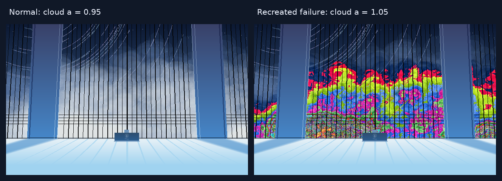

> この記事は[トラマト一人アドベントカレンダー](https://toramutton.me/advent2026/)の16日目の記事です。

## はじめに

こんにちはトラマトです。

大学生になって2回目の冬を迎え、特に今年は個人開発やArch Linuxなど、随分といろいろやってきたように思います。

しかし当然、その裏では普通にやらかしています。

設定をいじって環境をぶっ壊したり、無料のつもりが請求を食らったり、過去の履修判断に今さらキレたり。振り返ると結構ありました🤡

というわけで今回は、16日目の記事として **トラマト2026年やらかし大賞** を勝手に開催します！

被害額や当時の焦り、後悔などをもとに、独断と偏見で7位から発表していきます。ちなみに審査員も受賞者も自分です。

## 第7位：雲を薄くしようとして、虹色ノイズを生成

まずは、[5日目の記事](/blog/ba-bg-ruby/)で紹介した**Rubyでブルアカの背景を描いた課題**から。

(厳密には2025年なんですけど、書きたくなったので許してください泣)

空や雲、窓枠などをコードでチマチマ描いていたんですが、雲の透明度を調整しているときにやらかしました。

薄くてふわっとした雲を描きたかっただけなのに、出てきたのはなんと**虹色のノイズ**でした😭

_当時を再現した画像_

原因は、色を混ぜる式に渡す値を想定していた範囲より大きくしてしまったことでした。雲がもっと薄くなるつもりで数字を変えていたら、色の計算がおかしくなってひどい有様です。

詳しい仕組みは5日目の記事に書いてあるのでここでは割愛しますが、透明度という名前だけ見て数値をいじった結果、綺麗な風景から一気にディストピアへ飛ばされました。

ただ、今振り返るとこういう失敗かなり好きなんですよね。

当時は今ほど生成AIが強くなくて、グラフ用紙に座標を書き込み、画像を出しては数値を直し、また実行して……と、自分でチマチマ作っていました。

今ならAIに相談すればサクッと実装できてしまいそうですが、当時はこういう妙な現象にも全力で体当たりしていました。

まだ手書きの温もりが残っていた時代だったからこその面白さだなぁと思います。作業中の自分は困惑してたと思うが...😈

## 第6位：快適にしようとして、Hyprlandを破壊

続いてはArch Linuxです。まあ当然のようにランクインしてるよね。

[6日目の記事](/blog/make-arch/)でも書いたとおり、今年は導入から始まり、それから環境の設定をいじりまくりました。

自分好みの見た目、使いやすいキーバインド、気持ちいいアニメーション...などなど、ちょっと直すだけでも毎日の使い心地が変わるので、楽しいんですよね。

その結果、**Hyprlandの構成を数回ぶっ壊しました**。

よかれと思って設定を頑張ったのに、快適だった環境が逆に崩壊する。何してんねんすかね？？

ついさっきまで普通に使えていたPCに、自分で余計な仕事を増やしているんですよね。「ここをもう少し良くしたいな〜」から始まったはずなのに、途中から目標が「元の状態に戻したい😭助けて😭」になります。バカ？

しかも、そのPCは大学の課題も記事執筆もするための重要な道具です。環境を良くする作業で、作業できる環境を壊してるという。あまりにも本末転倒すぎる。

**大いなる快適さには、大いなる環境構築が伴う……**

~~どこぞのクソ重OS~~ Windows 11を自分好みにしようとしたときも、似たようなことをしていた気がします。結局どこに行っても環境構築してるなこいつ？

今は設定をGitで管理し、ノートPCにはスナップショットやLTSカーネルも用意しています。やらかしても戻れるので安心ではあります。まぁ壊さないのが一番なんですが🤡

## 第5位：Wi-Fiアダプタを買ったのに、結局有線へ

今年は[人生初の自作PC](/blog/pc-build-2026/)も組みました。

最初は「ネットはWi-Fiでええか！」と思い、**1,783円のWi-Fiアダプタ**を購入。

ところが、フォートナイトなどの通信ゲームで遊ぼうとすると様子がおかしい。

**なんと、待機島の時点で全てが固まる。**

まだ試合始まってないですよ‼️早く気づいて‼️

初めて自分で組んだPCでこれが起きると、ハチャメチャに怖いです。パーツ選びミスったのか…？組み立てで何かやらかしたのか...？などなど。

せっかく完成したPCがまともに動かないのかと思って、マジでヒヤヒヤしました。

最終的に有線LANに切り替えたらあっさり解決し、Wi-Fiアダプタは早々にお役御免。

**最初から有線にしておけば、この出費いらなかったじゃん……！！！**

金額だけならそこまで大きくないんですが、「人生初の自作PC、マジで失敗したかもしれん」というあの焦りのせいで印象に残っています。

ゲームを安定させるなら有線LANがオススメですよ！！本当に

## 第4位：無料のつもりで動かしていたBotから請求が来る

[2日目の記事](https://zenn.dev/toramutton/articles/fxtwitter-bot)で紹介した、Rust製のDiscord Bot。

Fly.ioで動かしているんですが、最初にメモリの割り当てを間違え、無料で動かすつもりだった構成からはみ出してしまいました。

しかも、そのまま気づかず1か月稼働。

そして請求メールがこんにちは。

**「えっ無料じゃないんですか！？！？！？」**

本当に見た瞬間これでした。

実際に払ったのは500円ちょいくらい。人生が終わるような請求ではありませんが、0円だと思ってたのにいきなり請求が来ると損した気分になりますよね...

便利なBotが動いているのを見て満足して、裏側の設定確認がおろそかになっていました、ほんまに。

動作確認だけして「ヨシ！」と言っている場合ではありませんでした。**設定と料金も確認してからヨシと言え！！！！！**

今回は500円くらいで済んだので、比較的安い授業料だったと思うことにします。NOPE買えたけど。

## 🥉第3位：Claudeに高い金額を払い続ける

ここからTOP3ですが、またまたお金の話です。

自分はClaudeのProプランをWebから契約していたんですが、**iOS版から契約する方が安かった**ことに後から気づきました。

具体的な料金は以下の通りです😢

- **Web版：月額22ドル**（日本の消費税10%込み）
- **iOS版：月額3,000円**（税込）

仮に1ドル160円で計算すると、Web版は月額3,520円。つまり、**同じProプランなのに毎月520円も違う**ことになります！！

Web版の請求履歴を確認すると、5月から10月までの6回分がありました。

単純計算で 520円 × 6か月 = **3,120円**。

まぁ実際の請求額は為替レートによって変わりますが、iOS版で契約していれば、この半年で約3,000円(！？)も節約できた計算です。

似たように使っているChatGPTのプランは月額3,000円ぴったりなんですよね。

だったら「Claudeの方はなんでこんなに高いんだろう...？」と、もっと早く疑問に思うべきでした😭😭契約方法をちょっと確認すればよかっただけなのに……。

これはもう、怠惰が招いた出費と言われても流石に仕方ないでしょう...

Botの請求はメールですぐ気づいたのに、Claudeは何か月も普通に払い続けているのが本当に良くない。毎月払うものほどちゃんと確認しておこうね😡

**ちなみに現在はiOS版に切り替えて無事に節約できています！**

もっと早く気づきたかった！！！！！！

## 🥈第2位：睡眠習慣がさらに崩壊

第2位は生活の話です。

高校時代までは、**23時には寝る**というルールをかなり守っていました。なんと、日付をまたぐのは年越しくらいでした(今思うと健康すぎでは...？)

それが大学1年生になると、寝るのが0時あたりになったり、休日は10時以降まで寝ていたり。じわじわと少しずつ崩れ始めていたんですが、今年はそれがさらに加速しました。

特に1月は深夜まで基礎科学実験に追われたせいだ！！！と言い訳したくなりますが...

実際、原因の9割くらいは**自分の意思の弱さ**なので、なんとも言えません😞

_まさにこれ_

高校時代は、時間の使い方といえばちょっとした勉強と趣味のゲームくらいでした。

あれから時間が経ち、今はそこに日々の課題やレポート、資格勉強、個人開発、記事執筆などが加わっています。単純にやりたいことも、やらなきゃいけないことも増えました。~~Twitterは昔から変わってませんが~~

ゲームもしたい！開発もしたい！記事も書きたい！でも課題も応用情報もある！そりゃ夜までかかりますよ！と言いたい。

……でもこれ、**早く寝て、朝に続きをやればいいだけじゃねぇか！！！**

我ながら正論ビームが耳に痛い。でも事実なんだよなぁ

やることが増えたのは事実ですが、それを全部「今日中にあとちょっとだけやろう」で夜に詰め込んでいるのは自分なんですよね。

PCの環境構築にはあれだけ緻密にこだわるのに、自分の就寝時間の設定はどんどん雑になっています。頼むからこっちもちゃんと管理してくれ。

一度の設定ミスと違い、毎日の話なので堂々の第2位。これは普通に改善したいです...

## 🥇第1位：英語演習を後回しにしたら、3年後期まで持ち越し

栄えある大賞は、こちら！！！

**英語演習の履修を後回しにしたこと。**

地味に聞こえるかもしれませんが、とにかく経緯を聞いてほしい。全てが究極にめんどくさい方向に噛み合いました。

### 卒業に必要な2単位

前提として、電通大の卒業要件には**「言語文化演習科目」を2単位取る**というものがあります。

これを自分は英語演習で満たすつもりでした。2年生以降に取る科目なので、なるべく早めに終わらせておきたかったんですよね。

残念なことに、TOEICで卒業基準の630点を超えることと、この2単位を修得することは別です。点数を取ったからといって、演習の単位まで消えてくれるわけではありません泣

### 余裕のあった2年前期を見送る

[2年前期の振り返り](/blog/uec-2s1-review/)にも書きましたが、この時期は金曜全休で毎週3連休とかいうオアシス。大学に入ってから一番余裕がありました。

おそらく、これから先も含めて最も楽な期間じゃないかな？と予想してるレベルです。

当然、この2年前期にも英語演習はありました。

ただ、TOEIC対策をするのは後期の授業。「どうせ取るならTOEIC対策も兼ねられる後期にするべ！」と考え、前期の履修を見送ったんです。

当時はそれでいいと思っていました。思っていたんですが...

### 先に730点を取ってしまう

ところが、2年前期の授業内で受けたTOEIC IPで **730点**を取りました。特に対策してないのに、なんで？？

英語演習を取る前に、卒業基準の630点を普通に超えました。これはもちろん嬉しかったです。

ただ、後期まで英語演習を待つ理由だったTOEIC対策の必要性は、少なくとも卒業基準という意味では薄れてしまいました。

**じゃあ前期に、別の英語演習を取っておけばよかったのでは……？**

### 後期、抽選落ち

そして2年後期。

予定どおり英語演習を取ろうとしたら、**抽選に落ちました**。

え？？？？？

後期に回した結果、後期にも取れませんでした。卒業に必要な2単位はそのまま続投です。

さらに3年前期は、MICS実験や3年次の英語科目(技術英語)との兼ね合いでそもそも取れず、**3年後期に回さざるを得ない**ことになりました。

早めに終わらせたかった科目、どんどん後ろへ追いやられてます💢

### あの前期に取っておけば……

もう一度言いますが、

**2年前期にも、TOEIC対策以外の英語演習はありました。**

あの余裕のある時期に取っておけば、こんなに後まで引きずらずに済んだはずなんですよね。

前期を見送り、先にTOEICの基準点を超え、後期は抽選に落ち、その次の前期も取れない。

一つ一つの出来事が全部つながって、めちゃくちゃ面倒な履修計画が爆誕しました。は？

今から前期の自分に言えることがあるなら、間違いなくこれです。

**「取れるうちに取っとけ！！！！！」**

というわけで、2026年のやらかし大賞は英語演習でした。受賞おめでとう、過去の自分💢💢💢

## おわりに

以上、笑いあり涙ありのトラマト2026年やらかし大賞でした！！

虹色の雲は今見ると面白いし、壊した環境も今はお気に入りです。Botもちゃんと動いています。こういう話を笑って書けるくらいには、そこら辺はまぁなんとかなりました。

ただ、睡眠習慣と英語演習の2強はまだ話が終わっていません。来年のトラマトさんがなんとかしてくれるといいなぁ。

とりあえず英語演習、次こそ履修させてください😭落とさないで😭

それでは！！

---

> 明日（12/17）は「Radeon＋ROCmでローカルLLM環境を作ってみた話」です！
